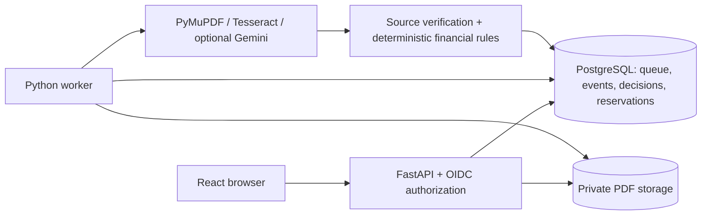

# InvoiceGuard AI

Invoice verification and exception management for the Zamp case study. React + TypeScript, FastAPI, PostgreSQL, a separate Python worker, PyMuPDF/Tesseract OCR and optional Gemini structured extraction. **Validation reserves PO capacity; it never pays an invoice.** All procurement and demonstration documents are synthetic.

The integrated workflow runs end-to-end: upload → persisted queue → digital extraction/OCR → evidence-backed facts → vendor/PO matching → Decimal financial controls → immutable decision and atomic reservation → human correction and full revalidation. See [verification](docs/completion-verification.md), [five-minute demo](docs/demo-guide.md) and [hosting instructions](deploy/README.md).

## Features and architecture

- Dashboard, Process Invoice, Decision Details, Exception Review, Purchase Orders and Audit History screens, responsive navigation and authenticated original-PDF preview.
- Bounded PDF ingestion, byte-hash replay detection, request idempotency, durable runs, worker leases and safe retries. Stored PDF bytes are checked against their original hash before extraction.
- Real Gemini REST adapter with structured schema, retries/timeouts, source evidence checks and conservative fallback. Gemini credentials are optional; live Gemini has **not** been verified here.
- Generic label and table extraction, OCR with bounded processes and one Tesseract thread, field-level source quotes/pages and geometry. Unsupported or ambiguous facts require review.
- Strong vendor identifiers take precedence over shared names; contradictions remain review and suspended/inactive vendors are blocked. No filename-specific business decisions.
- Deterministic currency, tax, item, quantity, status, date, duplicate and cumulative PO-balance rules. Monetary values cross APIs as decimal strings. USD/INR/EUR/GBP use two minor digits, JPY zero and KWD three, with ROUND_HALF_UP reconciliation.
- Review comments, attributed field/item corrections, optimistic version checks, preserved prior decisions, full revalidation, holds, atomic reservation replacement and explicit rejection/release. Corrections cannot bypass controls.
- OIDC/Auth0 Authorization Code + PKCE sign-in; RS256 signature/issuer/audience/expiry checks; server-managed workspace membership and VIEWER/REVIEWER/ADMIN permissions. Hosted startup refuses local authentication or local-only artifact storage.
- Private S3 documents shared by independently restartable web/worker containers; same-origin compiled React frontend served by FastAPI. PostgreSQL is the queue and source of truth; no extra broker/service is needed.



## Repository

`backend/app/` contains APIs, authentication, storage, extraction, validation, review and worker code; `backend/migrations/` contains Alembic migrations; `backend/scripts/` contains safe seed, access provisioning and evaluation commands. `frontend/src/` contains the application and pages; `frontend/e2e/` browser tests; `samples/` original regressions; `datasets/synthetic-v2/` frozen input corpus; `evaluation/synthetic-v2/` independent expected answers and historical reports; `deploy/` hosting configuration. Evaluation answers are excluded from runtime images and never loaded by normal application code.

## Run on your own computer

Requires Docker Compose v2, Python 3.12/uv, Node 24/npm and Tesseract English. These instructions create a website on the computer executing them. **A server in Codex Cloud cannot be opened through your laptop's loopback address. This task exposes no browser-preview or forwarded-port capability; see hosting below.**

From the repository root:

```sh
cp .env.example .env                 # ignored; keep real secrets out of git
# Edit only if needed; local defaults are synthetic and publicly documented.
docker compose up -d --wait db
cd backend
uv sync --frozen
uv run alembic upgrade head
uv run python -m app.seed           # original regression procurement; add-only
uv run python -m scripts.seed_workspace --process-examples
```

The second seeder creates **a separate workspace**, 18 vendors, 36 POs and 16 example submissions (eight baseline partials plus eight demonstrations). It never resets the legacy workspace. Repeating it replays deterministic PDF bytes without additional reservations. Select this workspace in your ignored `.env`:

```dotenv
LOCAL_WORKSPACE_ID=3c54d1c9-a0b2-57c9-bf7c-2d63178807d3
```

In three terminals (API and worker commands run from `backend`, UI from `frontend`):

```sh
uv run uvicorn app.main:app --host 127.0.0.1 --port 8000
uv run python -m app.worker.main
npm ci && npm run dev -- --port 5173 --strictPort
```

On that same computer, open the Vite address printed in its terminal. Vite proxies `/api` to FastAPI. `VITE_HOST=0.0.0.0` can bind all interfaces when an authorized forwarding facility exists; this alone does not create a public URL. Never expose unauthenticated local mode publicly. API documentation is at `/docs`; `/api/v1/health/ready` checks database connectivity and schema.

For one-origin verification, run `npm run build` in `frontend`, then open the API's root on the executing computer. FastAPI serves the actual compiled React app and SPA routes.

## Configuration

Copy `.env.example` and supply private values through environment variables or your host's secret settings. `DATABASE_URL` accepts PostgreSQL/psycopg and provider `postgres://` URLs. API and worker must share the database, artifact backend/bucket, region and Gemini settings. `STORAGE_DIR` paths are relative to `backend`.

Local: `APP_ENVIRONMENT=local`, `AUTH_MODE=local`, `STORAGE_BACKEND=local`, `LOCAL_WORKSPACE_ID` selects the synthetic workspace. There is no sign-in in local mode.

Hosted: `APP_ENVIRONMENT=production`, `AUTH_MODE=oidc`, `OIDC_ISSUER` (Auth0 HTTPS issuer ending `/`), `OIDC_AUDIENCE`, `OIDC_CLIENT_ID` (public SPA identifier), `STORAGE_BACKEND=s3`, `S3_BUCKET`, `AWS_DEFAULT_REGION` and restricted S3 credentials/identity. Optional `S3_ENDPOINT_URL` supports compatible storage; AWS itself needs no override. `GEMINI_API_KEY` is secret and optional; `GEMINI_MODEL` defaults to `gemini-2.5-flash`. Public runtime configuration exposes only OIDC public identifiers, never keys or database configuration.

## Tests and independent evaluation

Create the dedicated test database once (if it already exists, leave it alone):

```sh
docker compose exec db createdb -U invoiceguard invoiceguard_test
cd backend
uv run ruff check app tests migrations scripts
uv run ruff format --check app tests migrations scripts
uv run pytest -q
uv run alembic check
cd ../frontend
npm test
npm run build
npx playwright install chromium
cd ../backend
uv run python -m scripts.browser_regression
```

Backend tests truncate **only** a database whose name ends `_test`; never point `TEST_DATABASE_URL` at a demonstration database. Browser tests create/drop only databases owned by that invocation, use temporary documents and run API/worker/UI on test ports 8001/5174. Set `PLAYWRIGHT_CHROMIUM_EXECUTABLE_PATH` if using a system Chromium. `EVAL_ADMIN_DATABASE_URL` needs local CREATE DATABASE permission, never an unrestricted hosted production identity.

Frozen synthetic-v2 has 18 vendors, 36 POs, 80 development and 40 held-out invoice PDFs plus eight baseline PDFs. Existing fixtures, answer files and historical reports are retained. Development measurements can be repeated safely:

```sh
uv run python -m scripts.validate_dataset_v2
uv run python -m scripts.evaluate_dataset_v2 --mode extraction --split development --provider fallback --report ../.local/development-extraction.json
uv run python -m scripts.evaluate_dataset_v2 --mode gold --split development --provider fallback --report ../.local/development-gold.json
uv run python -m scripts.evaluate_dataset_v2 --mode worker --split development --provider fallback --report ../.local/development-worker.json
```

Use a new report path. Reports include numerators, denominators, unsupported extractions, review/decision outcomes, failures, hashes and source provenance. Gold mode tests business rules with assumed verified answers, not extraction. Worker mode measures extraction **and** persisted financial effects. Held-out answers must never become prompt examples or parser tuning inputs. New development results are not held-out generalization evidence; synthetic results do not establish real-world accuracy.

## Financial and identity assumptions

- One source document, many submissions/runs/revisions and one canonical business invoice are distinct identities. Exact bytes replay the previous run. Same vendor + normalized invoice number with different bytes is a business duplicate; conflicting/similar invoices require review. Retries/corrections do not inflate canonical invoice counts.
- The zero-overrun policy compares gross authorization against RESERVED + HELD + SETTLED commitments and item quantities. Financial finalization and review mutations serialize briefly per workspace in a PostgreSQL transaction; expensive extraction runs outside it. Database uniqueness prevents multiple consuming commitments per invoice.
- Opening review holds existing capacity. Passing revalidation atomically releases/replaces it; failed/review decisions retain the hold. Explicit rejection releases unsettled capacity and records a separate BLOCKED disposition with its actual event. Prior decisions are never rewritten. SETTLED exists for external AP reconciliation; there is no settlement/payment execution UI or endpoint.
- Positive invoices only; unsupported document types, ambiguous dates, missing fields and unsupported currencies require review. Calendar-2026 synthetic procurement validity is intentional. No real payments, bank details, tax compliance guarantees or exchange-rate conversion.
- Dashboard business counts represent latest original/canonical decisions; duplicate assessments, runs and submissions are separate operational metrics. Stage timelines render stored events, not simulated progress.

## Hosting and evaluator access

[deploy/render.yaml](deploy/render.yaml) prepares one Docker web service (React + API), one worker and private PostgreSQL. Documents live in a private S3 bucket. [Deployment instructions](deploy/README.md) specify Auth0 invitations, membership provisioning, restricted IAM, seeding and verification. The owner and evaluator receive separate sign-ins and server-selected synthetic workspaces; no shared password, API key or database access is needed.

**No hosted deployment has been activated.** GitHub publication was authorized on 1 November 2026; see [publication verification](docs/publication-verification.md) for its actual status. Paid hosting requires a current price quote and separate explicit approval. Render/Auth0/AWS credentials and provider egress permission are not configured in this cloud task. After approval, the provider-assigned HTTPS address must be verified before being presented as a live website.

## Limitations

Fallback extraction is deliberately conservative and still sends many unfamiliar/ambiguous invoices to review. OCR can misread scans; evidence matching is not a guarantee of semantic correctness. English Tesseract is installed by default. Gemini and hosted Auth0 require live credentialed verification. Real AWS IAM/encryption, Render provisioning, public HTTPS and evaluator login cannot be claimed from local tests. Dashboard/review queries suit demonstration volume, not an unbounded enterprise ledger. No antivirus service, payment integrations, arbitrary accounting policies or real-world extraction benchmark is claimed. See [verification](docs/completion-verification.md) for measured results and remaining blockers.
