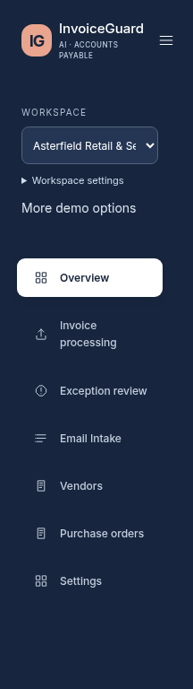
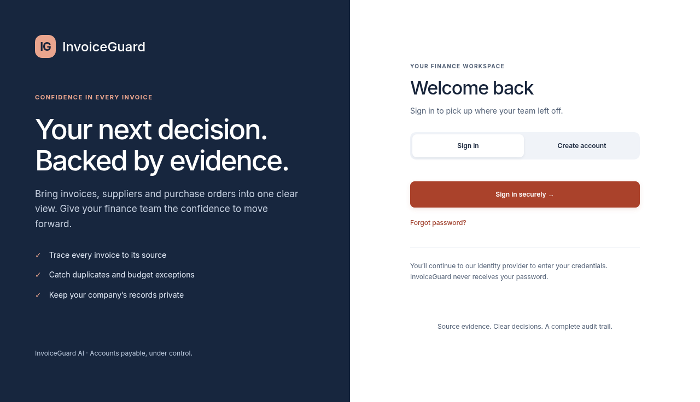
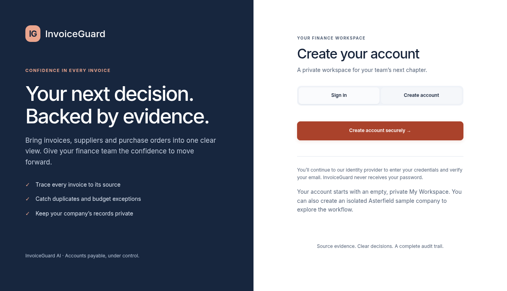
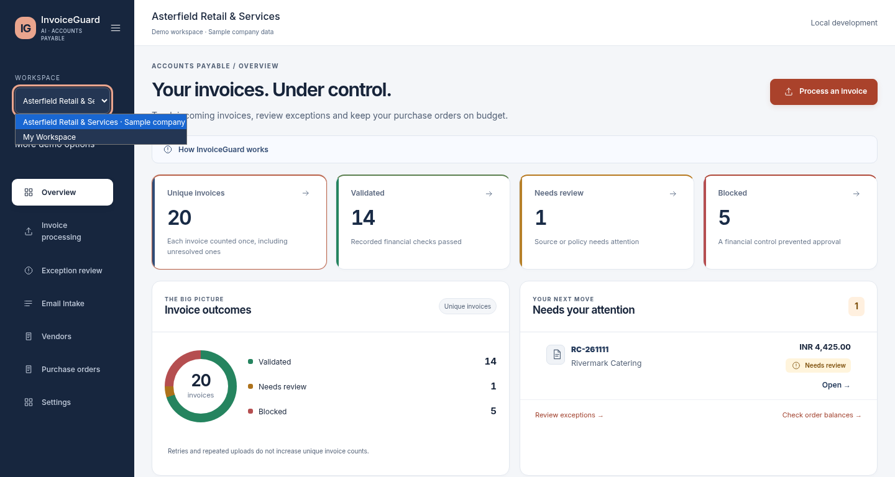
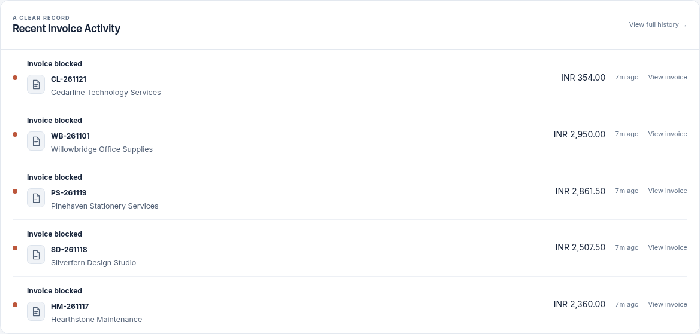

# Customer access, navigation and activity

This change extends the existing Auth0 SPA SDK and FastAPI OIDC verification. It does not deploy, execute payments, replace invoice processing, create a password database, or change financial decision rules.

## Identity provider setup

Use an Auth0 **Single Page Application** with Universal Login and a database or enterprise connection enabled for that application. Enable self-service signup on the selected database connection. The frontend supports Auth0-compatible authorization endpoints through the existing SDK; generic OIDC providers need an Auth0-compatible domain/endpoint contract or a separate SDK adapter.

1. Create an API identifier (audience), choose **RS256**, and allow offline access. Keep the issuer's trailing slash exactly as shown by the provider.
2. Configure `AUTH_MODE=oidc`, `OIDC_ISSUER=https://YOUR-TENANT.REGION.auth0.com/`, `OIDC_AUDIENCE=YOUR-API-IDENTIFIER`, and `OIDC_CLIENT_ID=YOUR-PUBLIC-SPA-CLIENT-ID` on the backend. These public identifiers come from `/api/v1/config`. Do not put an authentication client secret in frontend configuration.
3. For local provider testing, add `http://localhost:5173` to Allowed Callback URLs, Allowed Logout URLs, Allowed Web Origins and application origins. Add the exact HTTPS application origin to each list for a hosted installation. Redirects return to the application origin; application route restoration happens after the SDK validates state, nonce and the authorization code.
4. Enable authorization code + PKCE and refresh-token grants, **Refresh Token Rotation**, expiry and reuse detection. The SDK uses memory storage, requests `openid profile email offline_access`, and falls back to silent authentication. Do not enable implicit-flow token storage in localStorage. A refresh may require interactive sign-in if the provider session, cookie policy or refresh-token settings prevent silent restoration.
5. Enable provider email verification and configure its email sender/templates. If verification must precede API access, configure an Auth0 Post Login Action to reject unverified database identities (with an appropriate resend-verification flow). The account menu displays the provider's verification status. Registration and password reset happen on Universal Login; “Forgot password?” explains the provider recovery link. Enterprise/social account recovery follows that connection's provider policy.
6. Hosted installations must set a non-local `APP_ENVIRONMENT`, OIDC and private shared S3 settings as required by existing runtime validation. `AUTH_MODE=local` remains a developer-only bypass. Configure HTTPS, the exact audience and issuer, and keep web/worker settings consistent.

Gmail OAuth remains a separate Google client, consent flow and encrypted credential store. Preserve `GMAIL_ENCRYPTION_KEY` and the existing Windows callback `http://localhost:5173/api/v1/email/oauth/callback` (verify the full configured URI in your existing `.env`; do not overwrite it). Application login never connects Gmail.

No tenant, real user credentials or outbound provider credentials were available in this environment. The browser test exercises the real SDK's authorization request with code, S256 PKCE, state, nonce and signup hint, intercepting the external provider page. It is **not** a live-provider login. Before hosting, test actual registration, delivery of verification/reset emails, successful callback/token exchange, refresh, expiry, denied consent and provider logout with your configured tenant.

## Authorization and workspace behavior

- FastAPI validates RS256 signatures, issuer, audience, subject and token expiry. All existing workspace APIs retain server-controlled memberships and reviewer/admin permissions. Viewer mutation requests now fail centrally as well.
- Only authenticated `POST /workspaces/bootstrap` may provision a first user's My Workspace before membership exists. Ownership derives from the verified token, ignoring any supplied workspace header. Deterministic IDs and conflict-safe inserts make retries stable. Existing workspace ownership is checked before membership creation.
- My Workspace starts empty. The existing introduction explains suppliers, POs and PDF processing. “Create sample company” provisions that account's isolated Asterfield catalogue: 18 fictional suppliers, 36 POs and zero fabricated invoice decisions. Upload a sample PDF to exercise extraction and validation. No other account's records or Gmail credentials are copied. Repeated sample creation preserves edits and history; archived samples use the existing restore flow.
- Existing local Asterfield retains its ID and records and is disclosed as sample data, including after rename. The known legacy synthetic workspace is removed from the normal selector when Asterfield is available, while Settings retains access for history/archive/restore. Other customer workspaces are not deleted or globally hidden.
- Workspace switches cancel outstanding requests and discard late responses. Account changes, sign-out and expired sessions invalidate request epochs and unmount sensitive views. Tokens remain in SDK memory. Session storage holds workspace IDs, not invoice data.

## Safe Windows update

From your existing repository, stop the local API/worker/frontend before updating. Keep `.env`, PostgreSQL host port **5434**, database volumes and the Gmail encryption key unchanged. Do not run reset/reseed commands.

```powershell
git status --short
git pull --ff-only origin main
cd backend
uv sync --frozen
uv run alembic upgrade head
uv run alembic check
# Preview only; requires your existing active local Asterfield installation.
uv run python -m scripts.archive_legacy_demo
# Review the printed ID/version, then archive through the supported lifecycle:
uv run python -m scripts.archive_legacy_demo --version <printed-version> --confirm
cd ../frontend
npm ci
npm test
npm run typecheck
npm run lint
npm run build
npm run dev -- --host localhost --port 5173
```

There is **no new schema migration**. The cleanup CLI is explicit, local-only and recognizes only the original synthetic ID/name and an existing local Asterfield ID/owner. It refuses stale versions, active processing or conflicting ownership, uses the same archive lifecycle as Settings, and retains invoices, commitments, suppliers, POs and immutable audit events. If a workspace was renamed, use Settings to review/archive it manually instead. The user's Windows database was not reachable here; local archival must be performed there using the preview above. Restore is available in Settings.

For backend tests, use a **separate** database ending in `_test` on your PostgreSQL port 5434 via `TEST_DATABASE_URL`. Existing tests truncate only their isolated test tables; never point this variable at the application database. Browser tests also need a separately initialized test database, API and worker. Use Python 3.12 and Node 24.

## Navigation and activity

The sticky sidebar now has a bounded dynamic viewport height, a flexible `min-height: 0` scroll region and independently scrolling navigation. Branding stays outside the scroll region; workspace controls remain reachable, including expanded controls on short windows. Mobile navigation uses a bounded scroll area, hides closed items from keyboard navigation and restores focus to its toggle on Escape. Focus indicators remain visible.

Overview's **Recent Invoice Activity** requests up to five persisted business events with a positive server-side allowlist before pagination. It includes recorded decisions, saved corrections (explicitly marked as queued for revalidation), successful Gmail handoffs, and supplier/PO changes. It excludes OAuth startup, email checks, heartbeats, sample installation and polling. Invoice identity remains neutral; rows expose supplier, available amount/currency, outcome, timestamp and navigation. Full business history and the original technical audit disclosure remain available through the existing authorized audit route. Empty workspaces show an explanatory empty state.

## Verification

- Backend: **257 passed**, including existing extraction, financial checks, Gmail encryption/isolation and lifecycle tests. New tests cover two signed identities, first-user provisioning, forged workspace headers, isolated sample copies, denied viewer writes, filtering before pagination and explicit archival without historical record loss.
- Frontend: **59 passed**; TypeScript, ESLint, Prettier and production build pass. Auth unit tests cover registration intent, errors/loading, recovery guidance, session restoration, expiry and logout confirmation; client tests reject late responses after sign-out.
- Existing browser suite: **19 passed**, including real PDFs, OCR, duplicates, commitments, review corrections, Gmail provider-mocked handoff, reflow and accessibility. Existing assertions were not weakened.
- New browser checks: native Chromium zoom **100%, 125%, 150%, 200%** crossed with **768, 700, 600, 500px** base viewport heights; Settings reached by keyboard and mouse wheel. Mobile touch gestures, navigation close and focus return pass. New login accessibility and the SDK's code/PKCE redirect pass after correcting a small-text contrast issue. Provider content is intercepted only in the entry test.
- Backend Ruff lint/format and Alembic consistency pass; no new upgrade operations. Frontend TypeScript, lint, formatting and build results are recorded in the completion report.
- Production Docker build was attempted with the environment CA bundle and TLS verification. It reached dependency installation, then failed with `no space left on device` on the managed environment's 7.9 GB filesystem using the VFS storage driver. Only temporary build cache was reclaimed; no database volumes were removed. GitHub Actions runs the unchanged full production Docker build on its runner.

Screenshots are from this task's disposable local test database; installed Asterfield invoice decisions were produced by the actual worker. Temporary browser fixture workspaces were archived through lifecycle APIs before final screenshots. Login and registration show the application entry pages; provider-hosted credential forms require the configured tenant.






