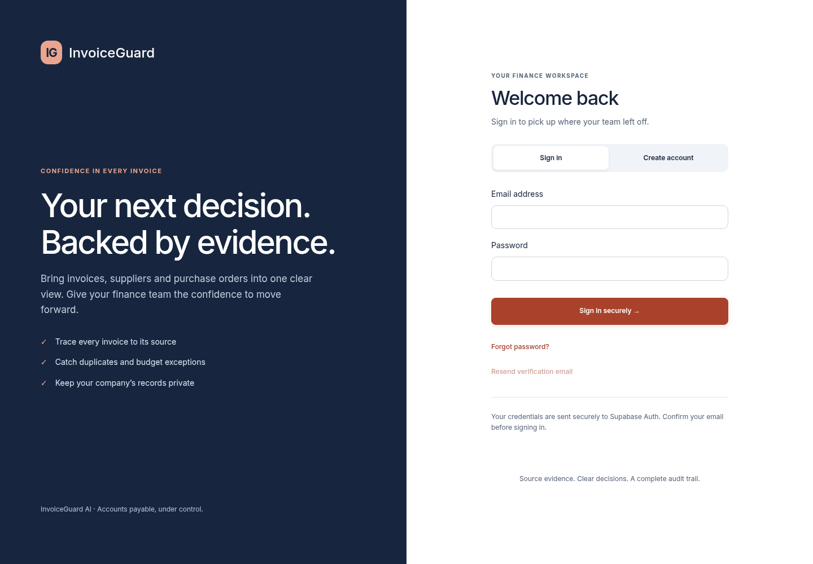
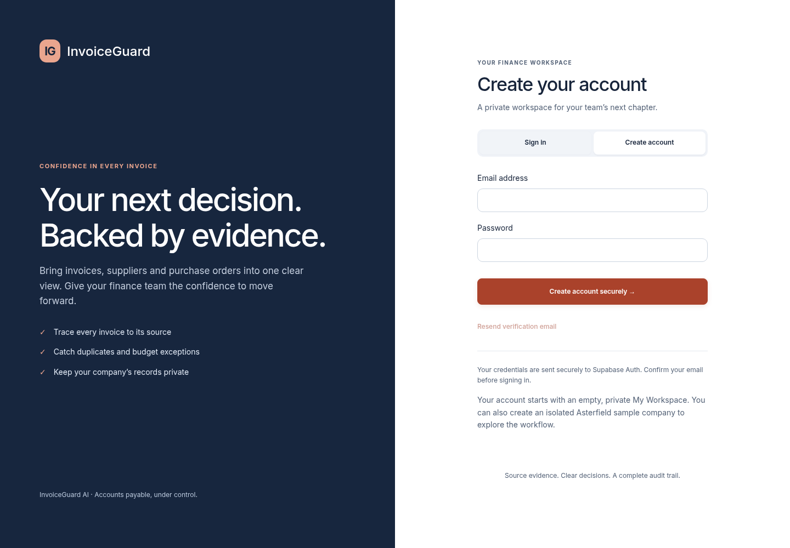

# Supabase authentication and private workspaces

Supabase stores account identities only. Invoices, procurement, commitments, immutable audit records and encrypted Gmail connections stay in the current PostgreSQL database. No schema migration or data copy is needed. Historical Auth0 memberships remain intact and are not automatically assigned to new accounts.

## Environment checklist

- Set `AUTH_MODE=supabase` on API and worker.
- Set `SUPABASE_URL=https://YOUR-PROJECT.supabase.co` (project origin without `/auth/v1`).
- Set `SUPABASE_PUBLISHABLE_KEY=sb_publishable_...` from project API settings. These public settings are provided to the browser by `/api/v1/config`; no `VITE_` variables are needed. Only public frontend settings may use a `VITE_` prefix.
- Issuer is derived as `${SUPABASE_URL}/auth/v1`; JWKS is `${SUPABASE_URL}/auth/v1/.well-known/jwks.json`. Audience is fixed to `authenticated`. ES256 and RS256 are allowed; shared-secret/HS256 tokens are rejected.
- Hosted environments require non-local `APP_ENVIRONMENT` plus existing shared private S3 and PostgreSQL settings. Local auth fails startup outside `APP_ENVIRONMENT=local`.
- Preserve the root `.env`, database credentials, Gmail encryption key, Google credentials and worker checkpoints. Add missing public settings without replacing that file. Never put service-role keys, secret keys, database passwords or Gmail keys into frontend values.

## Supabase configuration

1. Use the intended project. Enable Authentication → Providers → Email, allow signup, enable Confirm email, and disable anonymous sign-ins. Set a password minimum of at least 8 characters.
2. In Authentication → URL Configuration set Site URL to the app origin. Allow exact confirmation redirect `http://localhost:5173/` and recovery redirect `http://localhost:5173/?auth=recovery` locally. Add corresponding exact HTTPS URLs for hosting. Use the same browser and hostname for PKCE email links: the initiating browser stores the verifier.
3. Keep confirmation and recovery templates using Supabase's `{{ .ConfirmationURL }}` link. Configure SMTP delivery and suitable rate limits. The UI supports confirmation resend, neutral duplicate-account/recovery messages, and provider/network errors.
4. In Authentication → Signing Keys activate an asymmetric key: ES256 recommended, RS256 supported. Check the JWKS URL. Test rotation while both keys overlap before retiring the previous key; legacy shared-secret tokens are intentionally unsupported.
5. Confirmation links establish a session via the SDK's PKCE exchange. Recovery links return to `?auth=recovery`; private content remains closed until the password is updated. Successful reset signs out locally and requires a fresh login.
6. SDK browser storage persists sessions and refresh tokens automatically. Use HTTPS in hosting and keep the app origin trusted. Switching accounts clears workspace state, aborts pending requests and remounts private UI. Logout immediately closes private content; offline fallback signs out this device and reports that other sessions could not be revoked.

## Windows installation and startup (PowerShell)

Install Python 3.12+, uv, Node.js 24 LTS, Docker Desktop and Tesseract OCR on PATH. Keep the existing root `.env`. Only on a fresh clone, copy `.env.example` to `.env`. Add the three Supabase settings above, retain `APP_ENVIRONMENT=local`, and preserve existing storage and Gmail settings. `AUTH_MODE=local` is an explicit developer bypass only.

```powershell
# Repository root; preserve the existing PostgreSQL volume.
docker compose up -d
cd backend
uv sync --frozen
uv run alembic upgrade head
uv run uvicorn app.main:app --host 127.0.0.1 --port 8000
# Second PowerShell, from repository root
cd backend
uv run python -m app.worker.main
# Third PowerShell, from repository root
cd frontend
npm ci
npm run dev -- --host 127.0.0.1
```

Open `http://localhost:5173` consistently. Do not mix localhost and 127.0.0.1 for email callbacks. Never reset/reseed the existing database. First login creates an empty private My Workspace and shows the existing introduction. Asterfield samples are separately provisioned per account. Historical local records remain intact.

Gmail OAuth remains a separate Google app and consent flow. Keep the existing callback and encryption key. Sign in, select a private workspace, then choose Connect Gmail. Administrator membership, encrypted workspace-bound credentials, worker authorization and financial context remain enforced. Tokens never enter browser API responses.

## Live verification required

SDK browser tests control provider responses; JWT tests use real generated asymmetric keys. Neither proves live registration, SMTP delivery or real Gmail consent. With the real project, verify two independent accounts, confirmation, login, reload/refresh, password recovery, logout, expiry and account switching. Then connect each account's own Gmail mailbox and verify ingestion and denied cross-workspace access. No deployment is performed.

## Authorization and workspace behavior

- FastAPI validates ES256/RS256 signatures, issuer, audience, subject and token expiry. All existing workspace APIs retain server-controlled memberships and reviewer/admin permissions. Viewer mutation requests fail centrally.
- Only authenticated `POST /workspaces/bootstrap` may provision a first user's My Workspace before membership exists. Ownership derives from the verified token, ignoring any supplied workspace header. Deterministic IDs and conflict-safe inserts make retries stable. Existing workspace ownership is checked before membership creation.
- My Workspace starts empty. The existing introduction explains suppliers, POs and PDF processing. “Create sample company” provisions that account's isolated Asterfield catalogue: 18 fictional suppliers, 36 POs and zero fabricated invoice decisions. Upload a sample PDF to exercise extraction and validation. No other account's records or Gmail credentials are copied. Repeated sample creation preserves edits and history; archived samples use the existing restore flow.
- Existing local Asterfield retains its ID and records and is disclosed as sample data, including after rename. The known legacy synthetic workspace is removed from the normal selector when Asterfield is available, while Settings retains access for history/archive/restore. Other customer workspaces are not deleted or globally hidden.
- Workspace switches cancel outstanding requests and discard late responses. Account changes, sign-out and expired sessions invalidate request epochs and unmount sensitive views. API responses use `Cache-Control: no-store` to prevent HTTP caches from retaining financial responses after sign-out. Supabase persists its session in SDK-managed browser storage. Session storage holds workspace IDs, not invoice data.

## Verification report and screenshots

See [Supabase verification](supabase-verification.md) for current results and remaining live checks. Screenshots show the real application with controlled Supabase responses, not live registration.



