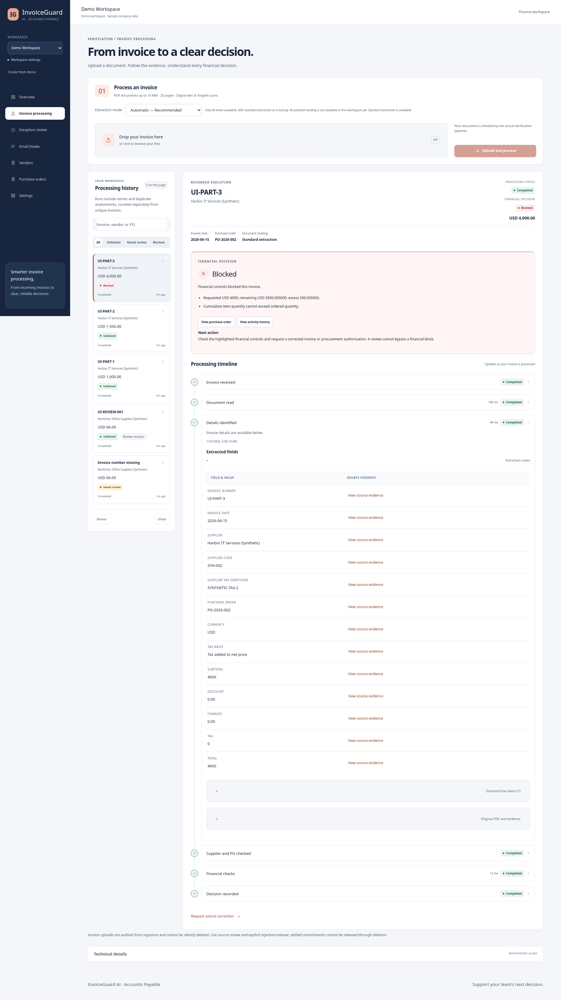
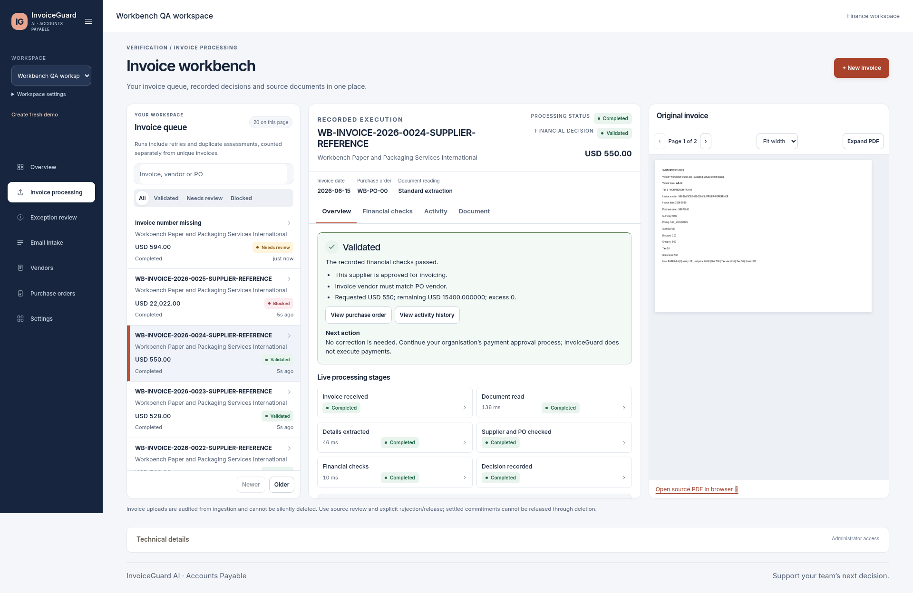
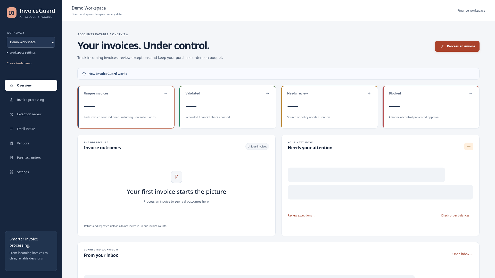
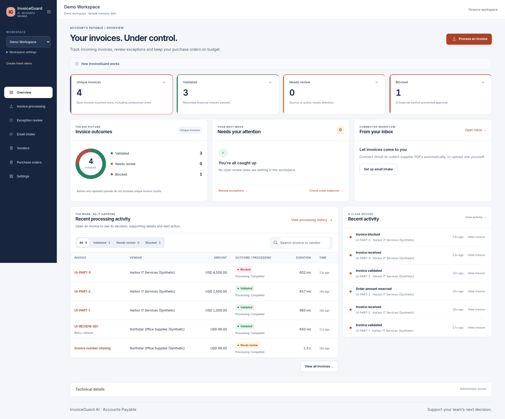
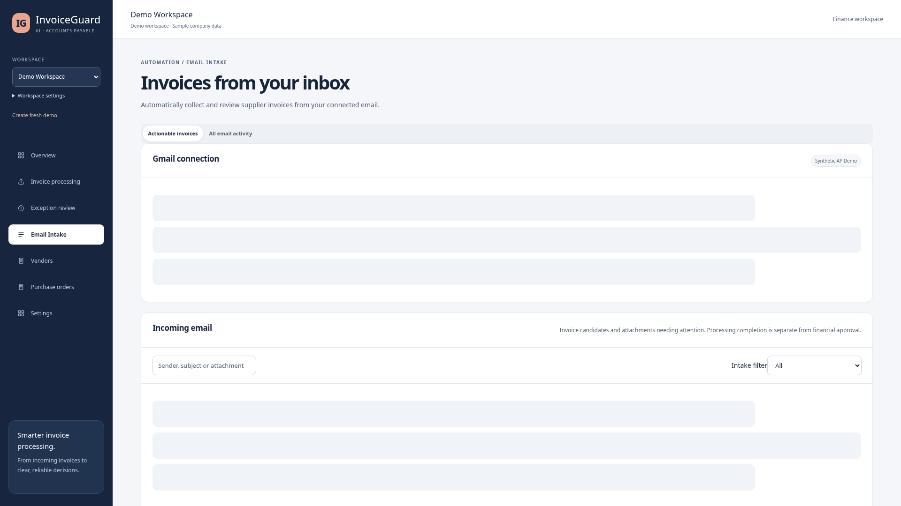
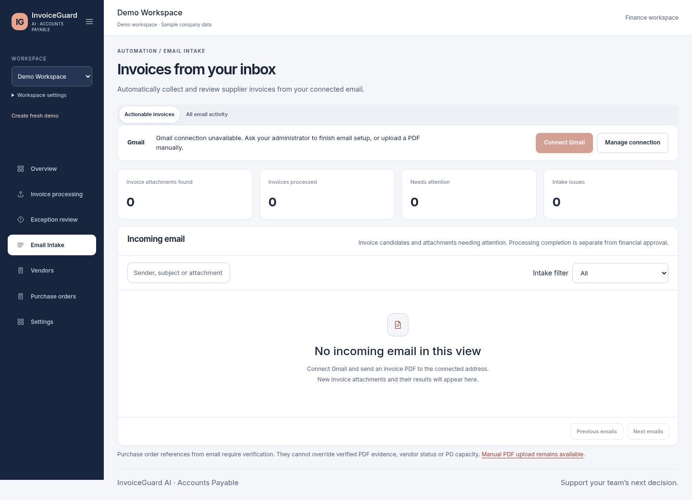

# Workbench verification — 6 November 2026

This report records the final UI workbench release. The completion response supplies the published commit SHA and verified GitHub Actions run. No deployment or paid plan was activated.

## Executed verification

| Check | Actual result |
| --- | --- |
| Backend pytest | **251 passed**, zero failed; 83.67 seconds; one upstream Starlette/httpx deprecation warning |
| Frontend Vitest | **39 passed**, zero failed, nine test files |
| Real-service Playwright | **17 passed**, zero failed/skipped; **3.3 minutes** (final full run) |
| Ruff lint / formatting | Passed; 107 Python files already formatted |
| ESLint / TypeScript / Prettier | Passed |
| Frontend production build | Passed |
| Migration/schema preservation | Passed in the backend suite, including actual `alembic check` against an owned temporary database |
| Docker production image | Passed; `invoiceguard-ai:invoice-workbench` |
| Frozen dataset integrity | **128 PDF hashes** verified; 80 development oracles checked; unchanged 18 vendors, 36 POs, 80 development / 40 held-out / 8 baseline PDFs |
| Production dependency audit | `npm audit --omit=dev --audit-level=high`: **zero known vulnerabilities** |
| Publication secret scan | Gitleaks 8.24.3 passed: **zero findings**, 421 publication source files; approximately 5.42 MB scanned |

Backend tests used a create-only UUID-named `*_test` database, removed only by its owning invocation. Browser tests use the existing isolated service runner: new owned database, temporary document storage, FastAPI, Python worker, Vite and real Chromium. No test truncates, seeds or resets the working demo database.

Commands actually executed:

```sh
# backend: TEST_DATABASE_URL supplied by a create-only owned-database harness
.venv/bin/python -m pytest -q
.venv/bin/ruff check app tests migrations scripts
.venv/bin/ruff format --check app tests migrations scripts
.venv/bin/python -m scripts.validate_dataset_v2
PLAYWRIGHT_CHROMIUM_EXECUTABLE_PATH=/usr/bin/chromium .venv/bin/python -m scripts.browser_regression

# frontend
npm install pdfjs-dist
npm run format
npm run typecheck
npm run lint
npm test
npm run build
npm run format:check
npm audit --omit=dev --audit-level=high
```

The production image was built against the explicitly selected managed local Docker socket with the existing `ca_bundle` BuildKit secret and TLS verification preserved. No image was deployed or pushed to a public registry. The Dockerfile is unchanged. Its existing `AUTH_MODE` name-based BuildKit warning does not identify an actual credential. Vite reports an informational size warning for the approximately 504 kB asynchronous PDF.js reader chunk; it is loaded on demand. The PDF worker is approximately 1.27 MB. No warning threshold was raised to suppress it.

## Real workflow coverage

All 15 original browser tests remain, with assertions updated for the new dialog/tab navigation. Two new tests bring the suite to 17:

- Actual PostgreSQL-backed 27-invoice queue with long invoice/vendor names, 20+7 server pages, search, selection, refresh, three actual financial outcomes, recorded event-count comparison and bounded procurement pages.
- Genuine Chromium browser zoom on every main route at all five requested levels.

The added fixture is test-only and refuses non-disposable/non-local databases. It creates its own workspace, **25 vendors, 25 POs and 27 two-page PDFs**. Invoices have distinct amounts, with validated, excessive-quantity/amount and missing-number cases. The worker and unchanged financial engine produce the decisions; these are not mocked decision payloads. No held-out answers are imported. The fixture is excluded from the runtime image with the other test modules.

Original coverage includes real review/correction/revalidation, cumulative overbilling, duplicates, missing fields, corrupt upload rejection, multi-page scanned OCR, procurement CRUD/CSV import, workspace isolation and rename/archive/restore, real Gmail handoff with mocked providers, actual persisted events, refreshed history and Asterfield replay. Gmail provider fixtures are explicitly mocks, not live mailbox deliveries.

## Responsive, zoom and accessibility evidence

- Eight main routes at **1920, 1440, 1280, 1024, 768 and 390 px**: 48 page screenshots and overflow assertions.
- All eight routes at **80%, 100%, 125%, 150% and 200% actual Chromium browser zoom**: 40 screenshots. The test changes default zoom through Chromium's own settings API in a disposable profile and asserts the zoom factor, resulting device pixel ratio, visible heading and page overflow. It does not substitute CSS zoom or pinch scaling for browser zoom.
- Separate selected-invoice screenshots at all six widths, three financial outcomes, laptop/tablet/mobile source-document tabs, upload dialog, collapsed navigation and additional rendered CSS zoom checks.
- A real source PDF is rendered, not an HTML facsimile: actual page count, next-page navigation, zoom, expanded dialog and successful canvas rendering are checked. Cross-workspace document reads return 404; the UI's denied-access/retry handling has a separate unit test.
- Focused email dialog screenshots at six widths, real review/source workbench and desktop/mobile Asterfield overview screenshots.
- Axe WCAG A/AA scans across main pages, focused email detail, Asterfield and selected workbench. Native dialog keyboard containment/Escape behavior and tab Arrow/Home/End focus semantics are exercised.
- Collapsed navigation is tested across desktop-to-mobile resizing while retaining workspace access. Narrow tables scroll within their boundary; they do not widen the page.

Screenshots were actually inspected, not merely generated. Inspection found and corrected queue-heading padding, crowded branding, shrinking queue rows, verbose stage expansion the cramped inherited upload-form columns, and the still-vertical Activity layout. The final Activity view is a compact event table with contextual disclosure and server pagination. A stale PO success message and test navigation races were also fixed; tests now wait for the actual save/detail/close flow rather than clicking through a native modal.

The first large-data fixture correctly triggered near-duplicate review because every document shared supplier/date/amount. Distinct fixture amounts fixed that test assumption; no financial rule was changed. An extension-based browser zoom experiment was unavailable on this Chromium build and was replaced with the verified built-in settings method. Earlier exploratory failures are not included as final passes. The first publication CI run passed 16 browser tests and exposed a mobile keyboard focus race: passive dialog cleanup could restore the old button after the menu was focused. Dialog opening/focus restoration now uses a layout effect, and the keyboard test explicitly checks modal removal and menu focus before Enter. This fixes focus timing without changing financial behavior or extending a timeout. The exact keyboard case also passed **3/3 repeated executions** (22.9 seconds) in a separate disposable environment.

## Before and after

The `before` screenshots were captured from a read-only copy of commit `5c19605c117d8a01037dffeb16bb0e54f051d521`, using isolated synthetic services. The `after` screenshots are actual rendered test applications, not static replacement pages. Records/counts may differ between isolated invocations; the comparison concerns layout, not financial performance.

| Before | After |
| --- | --- |
| Permanent upload card, tall queue cards and a long execution report | Upload dialog, compact paginated queue, tabbed details and adjacent source PDF |
| Outcome/review/inbox blocks stacked vertically | Compact real KPI/insight groups, preview rows and wide-screen activity composition |
| Large Gmail configuration section above the inbox | Connection status bar, focused management dialog and configuration in Settings |
| Long review page separating source and corrections | Bounded source/correction workbench with a persistent task queue |
| Repeated activity thread headings and long event cards | Compact 20-row business event table with retained contextual and raw records |

| Previous interface | Current working interface |
| --- | --- |
|  |  |
|  |  |
|  |  |

Additional inspected evidence: [source/correction review workbench](images/workbench-after-review.png), [compact Activity table](images/workbench-after-activity.png), and [mobile source PDF tab](images/workbench-after-mobile-pdf.png), [fixed upload dialog](images/workbench-after-upload.png), and [provider-mocked connected inbox](images/workbench-after-email-connected-mock.png).

The final full suite generated **124 PNG screenshots**. An additional isolated provider-mocked Gmail run captures explicit connected/disconnected page states without overwriting the full-suite artifacts.

Full artifacts remain under ignored `frontend/test-results/`. Representative before/after images above contain only synthetic fixture records. Screenshots are evidence of the working application, not a substitute frontend.

## Financial and security integrity

No production backend file, migration, procurement dataset, Asterfield asset, existing financial fixture or CI validation step changed. `backend/app/validation/engine.py` retains SHA-256 `f61250c319ad33e4457d6f4ffbcdaf35b5dbc9160a48b5728751408c05337072`.

Asterfield remains **18 vendors, 36 POs and 21 PDFs with 14 validated / 6 blocked / 1 review document outcomes**. One duplicate assessment means its dashboard correctly shows **20 unique invoices: 14 validated / 5 blocked / 1 review**. The installer/replay verification ran only in an owned test database; the working company was not reinstalled. Existing archive restrictions, financial commitments, immutable events, correction attribution and permissions remain unchanged.

Document bytes are fetched through the existing authenticated, workspace-scoped client. PDF.js runs locally in the browser; no document is sent to an external preview service. Original source quotes remain distinct from email PO candidates. Neither AI copy nor UI controls override financial outcomes or execute payments. Source references/licenses and distributed PDF.js notices are documented in [the experience guide](workbench-experience.md).

## Files changed

```text
README.md
backend/tests/browser_workbench_fixture.py
docs/images/workbench-after-activity.png
docs/images/workbench-after-email-connected-mock.png
docs/images/workbench-after-email.png
docs/images/workbench-after-invoice.png
docs/images/workbench-after-mobile-pdf.png
docs/images/workbench-after-overview.png
docs/images/workbench-after-review.png
docs/images/workbench-after-upload.png
docs/images/workbench-before-email.png
docs/images/workbench-before-invoice.png
docs/images/workbench-before-overview.png
docs/licenses/shadcn-MIT.txt
docs/licenses/tailadmin-MIT.txt
docs/workbench-experience.md
docs/workbench-verification.md
frontend/e2e/complete.spec.ts
frontend/e2e/email.spec.ts
frontend/e2e/product.spec.ts
frontend/e2e/redesign.spec.ts
frontend/e2e/workbench-zoom.spec.ts
frontend/e2e/workbench.spec.ts
frontend/e2e/workflow.spec.ts
frontend/e2e/zz-asterfield.spec.ts
frontend/package-lock.json
frontend/package.json
frontend/public/licenses/pdfjs-LICENSE.txt
frontend/public/licenses/pdfjs-NOTICE.txt
frontend/src/App.tsx
frontend/src/DocumentViewer.tsx
frontend/src/EmailIntake.test.tsx
frontend/src/Experience.tsx
frontend/src/InvoiceWorkflow.test.tsx
frontend/src/InvoiceWorkflow.tsx
frontend/src/POEditor.tsx
frontend/src/RunDetails.tsx
frontend/src/Workbench.test.tsx
frontend/src/Workbench.tsx
frontend/src/main.tsx
frontend/src/pages/Audit.tsx
frontend/src/pages/Dashboard.tsx
frontend/src/pages/EmailIntake.tsx
frontend/src/pages/PurchaseOrders.tsx
frontend/src/pages/Reviews.tsx
frontend/src/pages/Vendors.tsx
frontend/src/pages/WorkspaceSettings.tsx
frontend/src/run-data.ts
frontend/src/test-setup.ts
frontend/src/ui.tsx
frontend/src/vite-env.d.ts
frontend/src/workbench.css
```

## Limits and manual checks

Live Gmail, Gemini, Auth0 evaluator invitations, S3 and Render were not verified. Source-grounded business explanations use recorded rules; no additional generative narrative service is claimed. No real-world extraction generalization or thousands-of-record throughput claim follows from synthetic tests. Vendor/PO table pagination bounds DOM rows but uses the existing full-catalogue response; backend read contracts are unchanged.

Automated Chromium/Axe coverage is not a complete assistive-technology or cross-browser certification. Test the configured Windows environment, real mailbox consent/delivery, live Gemini identity/fallback truthfulness, browser PDF behavior and chosen evaluator sign-in before a hosted recording. Native zoom is now automated in Chromium; Firefox/Safari and Windows screen readers remain manual checks.

Use [the safe Windows CMD update and launch instructions](workbench-experience.md). Keep `.env`, port 5434, existing volumes, workspace IDs, Gmail history and stashes. Do not reset, reseed or regenerate Asterfield. No new migration is introduced. Provider setup and separate hosting approval remain before deployment.
